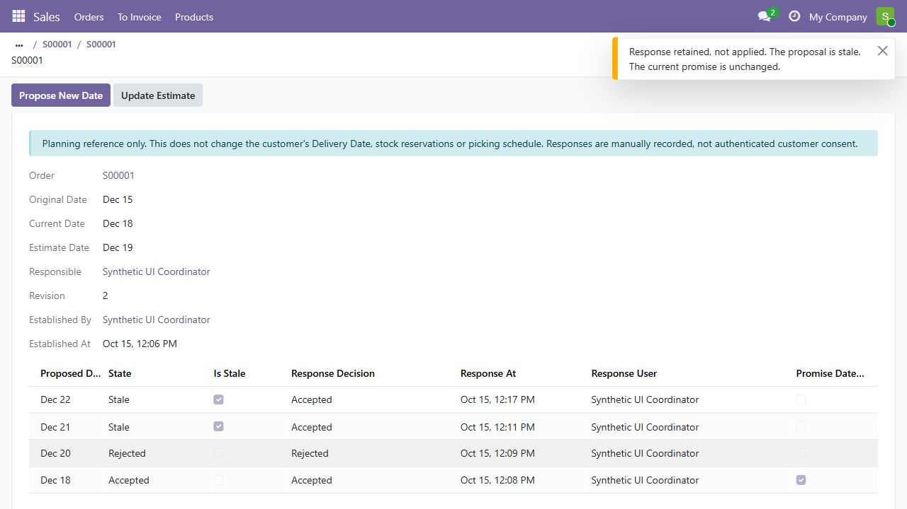

# Operations Control Tower 2.0

A synthetic Odoo 19 Community portfolio project: an operational follow-up
workspace, a warehouse dispatch-promise/customer-response gate, and a separate
optional locally validated campaign stock-automation addon.

The fictional scenario company is **HALY**, a powdered-drink manufacturer buying
raw materials from multiple suppliers and serving individual/corporate customers.
HALY identifies the fictional scenario; the software author is Yusuf Ondes.

## Portfolio overview - no installation needed

Start with the [14-slide business case PDF](docs/portfolio/HALY-Operations-Control-Tower-Case-Study-Revised.pdf)
or the [editable PowerPoint](docs/portfolio/HALY-Operations-Control-Tower-Case-Study-Revised.pptx).
They explain the stock gap, dispatch-date priority, in-house production and shipment
controls using actual synthetic demo screenshots. Technology is on the last slide.

Project ownership and business-rule decisions: Yusuf Ondes. Implementation,
testing and review used AI assistance; approval and validation evidence are
recorded in [the task registry](docs/TASKS.md). This is a synthetic portfolio
case, not a real-client rollout or measured ROI claim.

Latest local revalidation (2026-10-15): all 81 custom test methods, 3 promise
probes, 11 campaign cases, 24 HTTP operational checks and 7 configuration cases
passed. [TASK-0010](docs/TASKS.md#task-0010---rerun-the-complete-project-regression-and-operational-validation)
records exact commands, source digests, cleanup and exclusions.

Public source and presentation access were verified on 2026-10-15. After the
startup-health repair, [GitHub CI passed](https://github.com/yusufondes/Operations-Control-Tower/actions/runs/38769265214)
repository checks, the 8 base-addon tests and service health. This remote run
does not cover the full 81-method local validation. [TASK-0012](docs/TASKS.md#task-0012---final-public-portfolio-review-and-ci-repair)
records the publication, log-disclosure checks and original failure.

This is a local source/demo project, not a production deployment or a universal
fulfilment engine. Company/customer scenarios are fictional; no
affiliation or endorsement is implied. Publication preparation is tracked in
[TASK-0006](docs/TASKS.md#task-0006---prepare-a-truthful-portfolio-source-publication).
The bounded campaign implementation and its verification are tracked
in [TASK-0007](docs/TASKS.md#task-0007---complete-the-bounded-campaign-automation-before-publication).

## What is implemented

| Component | Demonstrated behavior | Boundary |
| --- | --- | --- |
| Operations Control Tower, 19.0.4.1.0 | Control items, owners, deadlines, next actions, views and role/company access | Follow-up workspace, not ERP integrations behind each card |
| Optional Dispatch Promise, 19.0.1.0.0 | Original/current/estimated dates, proposals, manual accepted/rejected response evidence, stale-scope and duplicate protection | Does not reserve stock, reschedule pickings or send messages |
| Optional Campaign Automation, 19.0.1.0.0 | Accepted-date reservation priority, protected confirmation history, complete consumer dispatch, corporate backorders and derived supply-risk ownership | Configured one-step make-to-stock, untracked goods only; see TASK-0007 for review and acceptance status |
| Standard fulfilment validation | Raw-material purchasing, own production, 900 units dispatched and corporate 300/200/100 batches | Synthetic diagnostic; reported business-rule gaps are not acceptance passes |

The promise addon and real-browser verification were accepted as scoped source/
test deliverables on 2026-10-15 (TASK-0004/0005). They are not installed in the
existing working database. The standard customer Delivery Date is separate
from the warehouse promise and is not rewritten by either integration addon.
TASK-0007's bounded campaign source/test delivery was explicitly accepted on
2026-10-15. The initial source publication is recorded under TASK-0006; the final
public publication is recorded under TASK-0012. Neither source publication
nor acceptance installs these addons in the working database. Source presence
alone is not test evidence.



See the [browser cases and limits](docs/evidence/task-0005/README.md) and the
[short demo](docs/DEMO.md). These saved images cover the accepted promise slice,
not the new campaign automation. They show synthetic records, not real consent.

## Business problem

Operational follow-up is often scattered across spreadsheets, messages, and meeting notes. That makes ownership unclear, hides blockers, and weakens management reporting. Operations Control Tower provides a compact, structured workflow for the items that need management attention.

Scenario: a seasonal campaign creates discounted-order demand while raw-material
availability and production constrain dispatch. Corporate orders may ship in
batches. The accepted slice preserves manually recorded customer-approved promise
history. The new campaign addon connects that accepted date to bounded reservation
and dispatch guards when standard Odoo events are recorded. It does not invent
physical receipt, manufacture, shipment or customer consent.

## Current capabilities

- Status-driven workflow with waiting, resolution, and closure states
- Manufacturing-oriented business areas and impact classification
- Owner, priority, deadline, status, and next-action tracking
- Overdue highlighting
- Kanban, list, form, calendar, graph, pivot, and search views
- Separate Operations User and Operations Manager access levels
- Optional demonstration records with relative deadlines
- Fictional portfolio scenarios for powdered-drink operations
- Automated model, validation, and security tests
- PostgreSQL and Odoo container health checks

The optional campaign source applies the approved policies: accepted warehouse
date, then protected current confirmation timestamp, then smaller order ID.
Unprepared campaign reservations can be reassigned; prepared/picked, completed
and outside reservations remain protected. Incomplete consumers retain allocated
stock but cannot dispatch partially. Corporate dispatch keeps outstanding
backorders rather than silently cancelling them. Missing accepted dates block
campaign allocation/dispatch and produce an owner/next action. These additions
passed the recorded TASK-0007 local checks, not a production-release claim.

Manual preparation cannot increase its pre-call allocation. Use Check Availability
to obtain stock through campaign priority. A partly prepared short consumer move
is protected as a whole; a warehouse operator must review/unprepare it and check
availability before adding newly arrived stock. No automatic unpicking is implied.

## Architecture

```text
Browser -> 127.0.0.1:8069 -> Odoo 19 -> PostgreSQL 15
                                |
                                +-> operations_control_tower (base + web)
                                +-> operations_dispatch_promise (optional sale_stock integration)
                                +-> operations_campaign_automation (optional bounded stock/supply integration)
```

See [docs/ARCHITECTURE.md](docs/ARCHITECTURE.md) for the design and security boundaries.

## Prerequisites

- Docker Desktop with Docker Compose v2
- PowerShell 7 or Windows PowerShell 5.1
- Python 3 for repository checks

## Fresh local base installation

Use this only for a new local demonstration environment. Bootstrap initializes
the base addon and sets the admin password; it is not a harmless check or an
upgrade procedure for an existing database. Never run it against valued data.

```powershell
git clone https://github.com/yusufondes/Operations-Control-Tower.git
cd Operations-Control-Tower
Copy-Item .env.example .env
# Replace the placeholder password in .env before continuing.
.\scripts\bootstrap.ps1
```

Open `http://localhost:8069` after bootstrap reports success. This installs only
Operations Control Tower and its portfolio examples, not the promise addon.

The bootstrap script securely prompts for an Odoo administrator password and requires at least 12 characters. The value is passed only to a temporary setup container and is not written to the repository.

See [docs/SETUP.md](docs/SETUP.md) for detailed operations, troubleshooting, and resolved implementation notes.

## Try the optional promise workflow

After fresh base setup, with Docker services running and local Odoo/PostgreSQL
images available, use the guarded disposable preview:

```powershell
.\scripts\preview-dispatch.ps1 -Action Start
```

The result reports an exact temporary URL, database/container names and a local
credential-file path. Open that file privately to sign in as the synthetic
coordinator; never paste it, commit it or include it in screenshots. No admin
reset or installation into the base database is needed. Follow the
[preview and cleanup instructions](docs/SETUP.md#optional-promise-preview) and
[promise walkthrough](docs/DEMO.md#dispatch-promise-walkthrough).

Stop the preview using its exact returned database/container identities when
finished. It shares local infrastructure but has a separate database and
container-local filestore. It is not a fully isolated or production-safe stack.

## Try the campaign preview under validation

Use the same prerequisites and cleanup procedure, with an explicit opt-in:

```powershell
.\scripts\preview-dispatch.ps1 -Action Start -WithCampaign
```

This creates the optional campaign addon only in the owned preview DB. Its
synthetic HALY fixture contains 500 opening units and discounted orders A (200),
B (600) and C (100), with expected reservations 200/300/0. It includes no purchase or
manufacturing fixture and performs no physical dispatch. The temporary preview
user combines Sales, Coordinator, Stock Manager and Operations Manager roles
for demonstration; runtime tests use separated roles. Follow
[campaign preview boundaries](docs/SETUP.md#optional-campaign-preview) and the
[campaign walkthrough](docs/DEMO.md#campaign-walkthrough-under-validation).

## Development commands

```powershell
.\scripts\start.ps1
.\scripts\stop.ps1
```

Do not treat module upgrade as a routine validation command. Historical
migrations can close existing items and insert demo data; read the preservation
warnings in [setup](docs/SETUP.md) before any separately approved upgrade.

## Demonstration

Follow [docs/DEMO.md](docs/DEMO.md) for a short portfolio walkthrough.

## Repository structure

```text
addons/operations_control_tower/  Custom Odoo addon
addons/operations_dispatch_promise/ Optional promise/history integration
addons/operations_campaign_automation/ Optional bounded campaign integration
config/                            Environment documentation
docs/                              Architecture, setup, and demo notes
scripts/                           Bootstrap and validation commands
.github/workflows/                 Continuous integration
compose.yaml                       Local Odoo and PostgreSQL stack
```

## Testing

Local validation:

```powershell
python .\scripts\check_repository.py
.\scripts\smoke-test.ps1
.\scripts\validate-fulfilment.ps1 -WithPromise
.\scripts\validate-fulfilment.ps1 -WithCampaign
```

The smoke command tests the base addon only, starts shared services and attempts
temporary DB/filestore cleanup; verify cleanup rather than assuming it succeeded.
The fulfilment runner needs an initialized base database and running services.
It uses a new guarded DB, not the working DB, and asserts its owned DB removal.
See [validation prerequisites and effects](docs/SETUP.md#validation).

`-WithCampaign` also selects the promise suite, installs the campaign addon only
in the owned test DB, and adds campaign end-to-end/connection probes. The
default standard diagnostic and explicit promise-only mode remain available.
TASK-0007 records the executed revision/results and independent-review gate;
the commands alone are not evidence of a pass.

Recorded campaign run on 2026-10-15: 81 methods (8 base + 22 promise + 51 campaign),
0 failures/errors; 11 campaign end-to-end/probe cases, including 900 units and six
real-connection pair scenarios. See [campaign evidence](docs/evidence/task-0007/README.md)
for the review-discovered defect, repair, browser proofs and remaining limits.

Recorded local evidence on 2026-10-15: 30 methods (8 base + 22 promise), 0 failures/
errors, controlled independent-connection and server Form probes, standard 900-unit
arithmetic, and separate real-browser cases. Runtime results are dated evidence,
not a guarantee for other environments or a remote CI result.

The current GitHub Actions definition checks repository text, compiles/tests only
the base addon, and checks service health. It does not run the optional promise
suite, fulfilment/connection probes or browser cases. See
[Actions](https://github.com/yusufondes/Operations-Control-Tower/actions) and
TASK-0012 for verified remote results. CI's volume-deletion cleanup belongs only
to its disposable runner;
never copy that cleanup into a local environment.

## Known limitations

- The current domain model focuses on operational control items rather than full project management.
- External system integrations are not included in the MVP.
- Graph/pivot analysis counts control items; stock, delivery/OTD and financial KPI engines are not implemented.
- The Docker configuration is intended for local development, not public production hosting.
- Customer responses are entered by an authorized employee, not authenticated by the customer.
- Campaign support is limited to one configured pool per warehouse, one-step make-to-stock deliveries and untracked storable goods. Unsupported routes or uncovered unmanaged competing demand fail closed rather than being silently ranked.
- Local campaign validation is recorded under TASK-0007; review and explicit owner acceptance remain distinct gates. The promise addon alone still does not allocate or enforce dispatch.
- Manual preparation uses existing allocation only; a partly prepared shortage needs explicit warehouse unprepare/recheck before additional reservation, not automatic unpicking.
- Supply-risk visibility derives late confirmed raw-material purchases for open production through a one-level BoM relationship. It is not exact supplier-to-order pegging, capacity optimization or a delivery guarantee.
- Quality release, carrier/WMS adapters, automatic customer messages, authenticated consent and production deployment are not provided. The standard customer Delivery Date and picking schedules remain separate.
- Consumer replacements after an earlier customer shipment require a separately supported workflow; ordinary inbound returns do not establish replacement support.
- Load, migration/backup restoration, mobile/browser matrices and forced-cleanup-failure recovery are not established by the local tests.

## Roadmap

1. Extend justified synthetic scenarios and agree measurable KPIs before building them.
2. Extend CI coverage to the optional suites and verify actual remote runs.
3. Add external adapters only with defined contracts; separately validate backup/restore and production deployment. Any live rollout needs separate approval.

## License

This project is licensed under the GNU Lesser General Public License v3.0. See [LICENSE](LICENSE).
